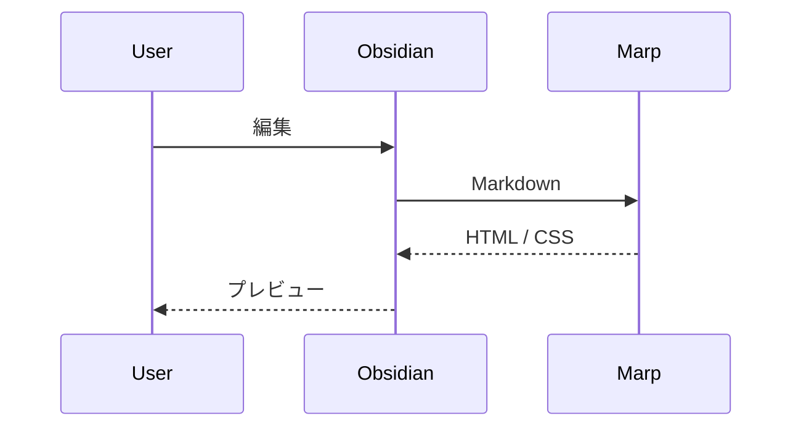
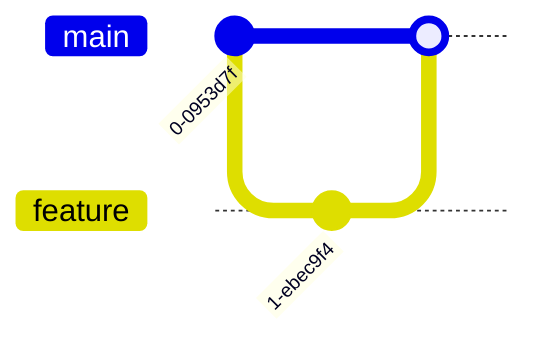

# コード

```ts
interface Slide {
	title: string;
	page: number;
}

const slides: Slide[] = [{ title: 'Hello, Marp', page: 1 }];
console.log(slides.map((s) => s.title));
```

---

## いろいろな言語

```python
def fib(n: int) -> int:
    return n if n < 2 else fib(n - 1) + fib(n - 2)
```

```bash
npm run build && echo "done"
```

```json
{ "marp": true, "theme": "default" }
```

---

## 長い行は自動縮小される

```js
const veryLongLine =
	'この行はとても長いので、Marp の auto-scaling によってコードブロック全体が縮小されて、スライドからはみ出さずに表示されるはずです';
```

---

## Mermaid: フローチャート


---

## Mermaid: シーケンス図



---

## Mermaid: 未対応の図

未対応の図はコードブロックとして表示される（エラーにならない）こと。


