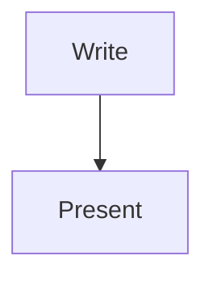

# Marp Core Slides

Math: $e^{i\pi} + 1 = 0$

$$
\int_0^1 x^2 \, dx = \frac{1}{3}
$$

---

## Code

```ts
const greeting: string = 'Hello, Marp';
console.log(greeting);
```

---

## Diagram



---

## Images


![[red.png|80]]


[Link to welcome](Welcome.md) :rocket:
